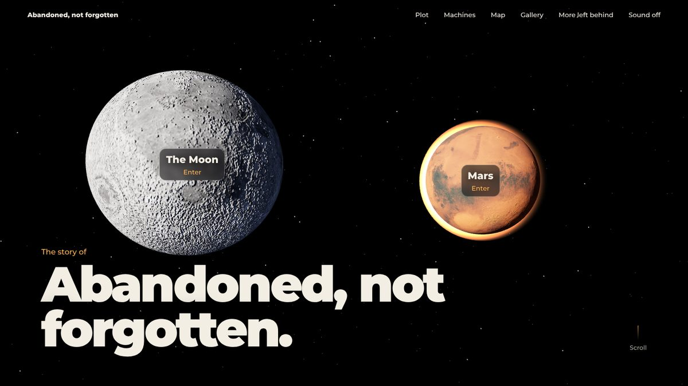

<div align="center">



# 🌑 Abandoned, not forgotten

### They left. The machines stayed.


**[▶ Open the live site](YOUR-LIVE-LINK)**

</div>

---

## 🌌 The idea

Astronauts stayed a few days. The machines they left were built to stay for years.

Some kept listening to the Moon until NASA pulled the plug in 1977. One little rover was meant to last a week and drove for **83 sols**. This site tells their stories, from launch to silence, over real 3D worlds.

## 🛰️ Meet the machines

| | Machine | Where | The story in one line |
|---|---|---|---|
| 🌙 | **ALSEP** | The Moon | Nuclear-powered science stations that listened to moonquakes until they were switched off |
| 🚀 | **Lunar Module descent stage** | The Moon | The landing pad that became a launch pad, and still sits in the Ocean of Storms |
| 🤖 | **Sojourner** | Mars | Built for a week. Worked for 83 sols. Still parked in Ares Vallis |

…plus **10 more** abandoned machines (rovers, landers, probes) in the "More left behind" drawer, each linking to NASA.

## 🎬 What you can do

- 🪐 **Real 3D Moon and Mars.** The camera follows your scroll. Click a planet to fly to its story.
- 📖 **Every story has the same arc:** why it was built, what it found, how it ended, what remains.
- 🎧 **Original ambient score**, generated live in your browser. Or enter silent.
- 🗺️ **Interactive map** of the Moon and Mars with the real landing sites.
- 🤖 **Mission Researcher** — an AI chat agent that answers questions about the machines. Every story panel, gallery photo and drawer entry has an "Ask the researcher" button.
- 📱 **Works on phones**, with keyboard support and reduced-motion mode.

---

## 📁 Project structure

```
.
├── backend/                 # FastAPI server
│   ├── main.py              # app, static serving, /api/agent, /api/health
│   ├── agent.py             # the researcher agent (Grok xAI / Groq)
│   ├── requirements.txt
│   └── .env                 # your API key (never commit)
├── frontend/                # the site, served as static files
│   ├── index.html           # single-page app (HTML/CSS/JS + three.js)
│   ├── assets/              # images + extracted planet textures
│   ├── vid/                 # background videos
│   ├── llms.txt             # for AI crawlers (ChatGPT, Perplexity, ...)
│   ├── robots.txt
│   └── sitemap.xml
└── GUIDE.md                 # detailed setup & usage guidance
```

## 🛠️ Built with

- **Frontend:** plain HTML, CSS and JavaScript, [three.js](https://threejs.org/) for the planets, Web Audio API for the music. No framework, no build step.
- **Backend:** [FastAPI](https://fastapi.tiangolo.com/) (Python) with one agent endpoint.
- **Agent:** [Grok (xAI) API](https://x.ai/api) with server-side web search, or any [Groq](https://groq.com) chat model as a fallback.

## 🚀 Quick start

```bash
# 1. install backend dependencies
cd backend
python -m venv .venv
.venv/Scripts/activate        # Windows  (macOS/Linux: source .venv/bin/activate)
pip install -r requirements.txt

# 2. add your API key to backend/.env
#    - xAI (Grok) key from https://console.x.ai  -> agent + AI web search
#    - Groq key (starts with gsk_)               -> agent, no web search
#      (enable a model in https://console.groq.com/settings/limits)

# 3. run the server
uvicorn main:app --reload

# open http://localhost:8000
```

## 🤖 Mission Researcher

A chat agent tab in the nav. It knows the site's mission facts from its system prompt, and with an xAI key it can also search the web live (toggle **AI search** in the chat panel).

| Provider | Key prefix | AI web search | Default model |
|---|---|---|---|
| xAI (Grok) | `xai-` | yes | `grok-4.7` |
| Groq | `gsk_` | no | `openai/gpt-oss-120b` |

### API

- `POST /api/agent`
  ```json
  {"message": "Why did NASA switch off ALSEP?",
   "history": [{"role": "user", "content": "..."}],
   "search": true}
  ```
  returns `{"reply": "..."}`
- `GET /api/health` — `{"ok": true, "agent": true, "provider": "xai", "search": true}`

### Configuration (backend/.env)

| Variable | Default | Purpose |
|---|---|---|
| `GROK_API_KEY` | — | your xAI or Groq key |
| `GROK_MODEL` | `grok-4.7` | model used with xAI |
| `GROQ_MODEL` | `openai/gpt-oss-120b` | model used with Groq |

## 🌍 Deploying

The SEO/GEO files use the placeholder `YOUR-SITE.vercel.app`. Before deploying, replace it in:

- `frontend/robots.txt`
- `frontend/sitemap.xml`
- `frontend/llms.txt`
- `frontend/index.html` (canonical, `og:url`, `og:image`, `twitter:image`)

## 👤 Made by

**Abdullah Zeshan**, a solo build.
[LinkedIn](https://linkedin.com/in/abdullah-zeshan-4706a02a3) · [GitHub](https://github.com/abdullah-zeshan)

## 🙏 Credits

- **Facts:** NASA NSSDCA and NASA mission pages.
- **Photos:** NASA and NASA/JPL-Caltech.
- **Planet textures:** NASA-derived maps from [threex.planets](https://github.com/jeromeetienne/threex.planets).
- **Background videos:** stock footage from [Pexels](https://www.pexels.com/) and [Pixabay](https://pixabay.com/). It is illustrative, not actual mission footage.
- **Music:** original, generated in the browser.

> Independent project. Not affiliated with or endorsed by NASA. Map positions are approximate.

<div align="center"><sub>Made for the NASA Space Apps Challenge 2026.</sub></div>
